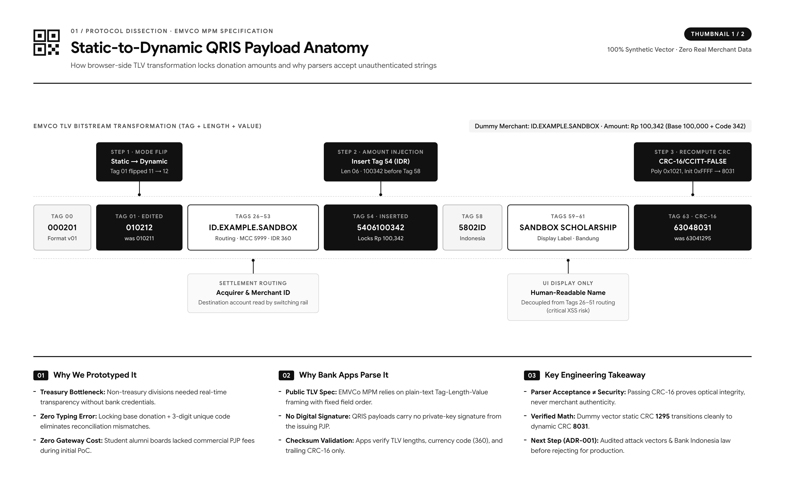
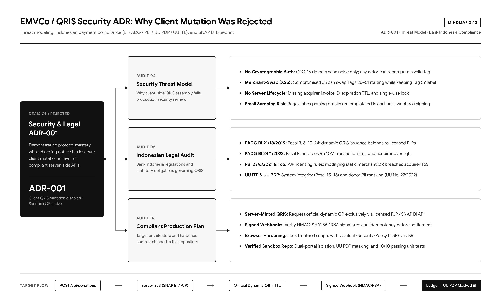

# Dynamic QRIS Injection Dynamics & Regulatory Compliance ADR

An **EMVCo / QRIS Protocol Engineering & Security Architecture Decision Record (ADR)** examining client-side static-to-dynamic QR payload injection (TLV mutation & CRC-16/CCITT-FALSE), why it was deliberately **NOT implemented in production due to Indonesian payment regulations**, and the accompanying IKA UPI scholarship sandbox platform.

> **Core Engineering Takeaway:** This repository documents both **how** client-side static-to-dynamic EMVCo/QRIS payload transformation works at the TLV/CRC-16 level and **why we deliberately chose NOT to ship it to production** after conducting a security threat model and Indonesian payment-regulation audit. The runnable web app uses a safe, non-transactional sandbox invoice QR (`DEFAULT_DEMO_MODE: true`) with zero live credentials or merchant identifiers.

### Visual Architecture & Security Overview





---

## 1. Problem Statement & Why the QR Prototype Was Built

Campus and alumni scholarship boards face three recurring operational problems:

1. **Treasury Bottleneck:** Non-treasury divisions (PR, Outreach, Scholarship Committee) must repeatedly contact the treasurer to check incoming funds and verify donor totals.
2. **Manual Reconciliation & "Silent Donors":** Donors transfer arbitrary amounts via static QRIS or bank transfer without filling out a confirmation form, forcing manual ledger matching.
3. **Zero Budget for Paid Payment Gateways:** Student/alumni foundations rarely have the legal entity status or recurring fee budget required to onboard commercial payment gateways during early prototyping.

To remove donor typing errors and attach a 3-digit unique reconciliation code (e.g., `Rp 100,000` + `342` = `Rp 100,342`), our initial academic prototype explored converting a static **EMVCo Merchant-Presented Mode (MPM)** QRIS string into an amount-locked dynamic QR payload in the browser.

---

## 2. Technical Deep-Dive: How EMVCo MPM QRIS & CRC-16 Work

Indonesian **QRIS** follows the public **EMVCo QR Code Specification for Payment Systems (Merchant-Presented Mode / MPM)**. Every QR string is a flat ASCII sequence of **Tag-Length-Value (TLV)** objects (`2-digit Tag` + `2-digit Length` + `Value`), terminated by a 4-hex-character **CRC-16/CCITT-FALSE** checksum.

### 2.1 EMVCo MPM TLV Structure (100% Synthetic Example)

Using a **strictly synthetic dummy merchant** (`ID.EXAMPLE.SANDBOX`, zero real merchant data):

| Tag | Meaning | Static Value | Dynamic Value (Rp 100,342) |
| :--- | :--- | :--- | :--- |
| `00` | Payload Format Indicator | `01` (`000201`) | `01` (`000201`) |
| `01` | Point of Initiation Method | `11` = Static (`010211`) | `12` = Dynamic (`010212`) |
| `26` | Merchant Account Information (Nested TLV: Acquirer domain + Merchant ID) | `0018ID.EXAMPLE.SANDBOX0118999900000000000001` | Unchanged |
| `52` | Merchant Category Code (MCC) | `5999` (`52045999`) | `5999` (`52045999`) |
| `53` | Transaction Currency (ISO 4217: IDR) | `360` (`5303360`) | `360` (`5303360`) |
| `54` | **Transaction Amount** | *(omitted in static QR)* | **`100342` (`5406100342`)** |
| `58` | Country Code | `ID` (`5802ID`) | `ID` (`5802ID`) |
| `59` | Merchant Name (UI display label) | `SANDBOX SCHOLARSHIP` | `SANDBOX SCHOLARSHIP` |
| `60` | Merchant City | `BANDUNG` | `BANDUNG` |
| `61` | Postal Code | `40154` | `40154` |
| `63` | **CRC-16/CCITT-FALSE** (`poly=0x1021`, `init=0xFFFF`) | `1295` (`63041295`) | **`8031` (`63048031`)** |

### 2.2 Transformation Flow (Why Banking Apps Parse It)

```text
Synthetic Static EMVCo String:
  000201010211...5303360 5802ID5919SANDBOX SCHOLARSHIP6007BANDUNG6105401546304 1295
          ^^^^                                                                ^^^^
        Static (11)                                                         Old CRC

  Step 1: Strip last 4 hex chars (old CRC)
  Step 2: Flip Tag 01 from 010211 (Static) -> 010212 (Dynamic)
  Step 3: Insert Tag 54 ("54" + "06" + "100342") immediately before Tag 58 ("5802ID")
  Step 4: Recompute CRC-16/CCITT-FALSE over the entire string up to and including "6304"

Synthetic Dynamic EMVCo String:
  000201010212...5303360 5406100342 5802ID5919SANDBOX SCHOLARSHIP6007BANDUNG6105401546304 8031
          ^^^^           ^^^^^^^^^^                                                      ^^^^
       Dynamic (12)      Injected Tag 54                                               New CRC
```

Banking and e-wallet apps accept this string because the parser only verifies TLV framing, field constraints, and the trailing CRC-16 checksum. **That exact design property is why client-side QRIS generation is unsafe for production.**

---

## 3. Why We Deliberately Rejected Client-Side QRIS for Production

After evaluating the prototype against both offensive threat modeling and Indonesian financial law, we **removed client-side QRIS mutation** and replaced it with a non-transactional sandbox QR. Full analysis is documented in [docs/SECURITY_ADR_QRIS.md](docs/SECURITY_ADR_QRIS.md).

### 3.1 Security Threat Model

| Risk | Mechanism & Impact |
| :--- | :--- |
| **CRC-16 Is Not a Cryptographic Signature** | CRC-16 only detects optical scan corruption. Anyone can modify any tag in the string and recompute a valid 4-hex checksum without a private key. |
| **Merchant-Swap / Silent Fund Redirection (XSS & Supply Chain)** | Because the QR string is built in browser JavaScript, an attacker who gains XSS or compromises a frontend asset can swap **Tags `26-51`** (Merchant Account / NMID routing) to their own account while keeping **Tag `59`** (Merchant Name) looking legitimate, then recompute CRC-16. Donors unknowingly pay the attacker. |
| **No Server-Side Invoice Lifecycle** | Client-mutated static QRIS has no acquirer-tracked invoice ID, no expiration TTL, and no single-use lock. The same QR can be replayed indefinitely, causing duplicate or unlinked payments. |
| **Email Scraping Is Not a Settlement Source of Truth** | Parsing inbox mutation emails via regex is fragile against template changes and vulnerable to spoofed emails if DKIM/SPF and sender identity are not cryptographically verified. |

### 3.2 Indonesian Legal & Regulatory Audit

| Regulation | Scope & Why Client-Side Static-to-Dynamic QRIS Fails Compliance |
| :--- | :--- |
| **PADG BI No. 21/18/PADG/2019** *(Pasal 3, 6, 10, 24)* | Establishes QRIS national standard governance. Issuance, routing, and dynamic QRIS generation are regulated responsibilities of licensed **PJP (Penyedia Jasa Pembayaran)** and switching operators, not ad-hoc client-side scripts. |
| **PADG BI No. 24/1/PADG/2022** *(Pasal 8)* | Amends QRIS implementation rules, including the Rp 10,000,000 per-transaction limit and acquirer-side compliance obligations. |
| **PBI No. 23/6/PBI/2021** | Regulates Payment Service Providers (PJP), mandating licensed oversight, security standards, and consumer protection for payment initiation flows. |
| **UU ITE (UU No. 11/2008 jo. UU No. 1/2024, Pasal 15-16)** | Requires Electronic System Operators (PSE) to operate systems reliably, securely, and responsibly, protecting the integrity and authenticity of electronic transaction records. |
| **UU PDP (UU No. 27 Tahun 2022)** | Requires explicit protection of personal data (donor names, student IDs, phone numbers). Addressed in this platform via automated PII masking before data reaches public dashboards or Looker Studio. |
| **PJP / Acquirer Terms of Service** | Standard merchant agreements (DANA Bisnis, GoPay Merchant, bank acquirers) prohibit tampering with or programmatically altering issued static QRIS payloads outside official merchant APIs, risking account freeze. |

---

## 4. Compliant Production Blueprint (Target Architecture)

In a real production deployment, dynamic QRIS generation and reconciliation must move entirely server-side behind a licensed PJP or **SNAP BI (Standar Nasional Open API Pembayaran)**:

```text
Donor Browser
   |  1. POST /api/donations (amount, donor metadata)
   v
Backend API (Authenticated Server, NOT browser JS)
   |  2. Signed S2S Request (SNAP BI / Midtrans / Xendit / Official PJP)
   v
Licensed PJP / Acquirer
   |  3. Mints official Dynamic QRIS + invoice_id + expires_at (single-use)
   v
Donor Browser (Renders server-issued QR string under strict CSP & SRI)
   |  4. Donor pays via any QRIS-compatible bank or e-wallet
   v
Licensed PJP -> Webhook (HTTPS POST + HMAC-SHA256 / RSA Signature) -> Backend API
   |  5. Verifies signature, exact amount, and idempotency key
   v
Ledger Database (SETTLED) -> UU PDP Masked View -> Looker Studio BI
```

---

## 5. Platform Architecture (Implemented Sandbox System)

Beyond the QRIS ADR, the repository includes the complete dual-portal data management and transparency platform built for the IKA UPI case study:

```text
+-----------------------------------+       +------------------------------------+
|  Portal 1: dist_donatur/          |       |  Portal 2: dist_admin/             |
|  Public Donor & Transparency UI   |       |  Internal Governance & Recon UI    |
|  (Zero links to admin portal)     |       |  (Zero cross-links to donor UI)    |
+-----------------+-----------------+       +------------------+-----------------+
                  |                                            |
                  +---------------------+----------------------+
                                        | HTTPS JSON API
                                        v
                   +----------------------------------------+
                   |  Google Apps Script Backend (Code.gs)  |
                   |  - 3-Path Donor Intake & Validation    |
                   |  - UU PDP PII Masking Pipeline         |
                   |  - Ledger Reconciliation Engine        |
                   |  - Telegram / Email Dispatchers        |
                   +-------------------+--------------------+
                                       |
                     +-----------------+-----------------+
                     |                                   |
                     v                                   v
      +-----------------------------+     +-----------------------------+
      |  Google Sheets Data Store   |     |  Google Looker Studio BI    |
      |  - master_alumni            |     |  - Masked Public Analytics  |
      |  - raw_donations (Ledger)   |     |  - Faculty & Cohort Rollups |
      |  - public_masked_view       |     |  - Settlement Breakdown     |
      +-----------------------------+     +-----------------------------+
```

### Key Implemented Controls
- **Dual-Portal Isolation (`build_dist.js`):** Automatically fails the build if `dist_donatur/index.html` links to admin or `dist_admin/index.html` links to donor, and blocks stray `.html` files in root.
- **Segregation of Duties:** Non-treasury divisions monitor real-time scholarship progress and faculty breakdowns without treasury bank credentials.
- **3-Path Donor Ingestion + Silent Donor Matching:** Supports Verified Alumni NIM lookup (Path 1), Fast-Track Onboarding (Path 2), Express Anonymous (Path 3), and `UNCLAIMED_DIRECT_TRANSFER` reconciliation (Case 4).
- **UU PDP Privacy Masking:** Masks donor names (`Fadhil Ramadhan` -> `Fa*** Ra***`) and WhatsApp numbers (`08122001234` -> `0812****234`) before rendering in public feeds.

---

## Repository Structure

```text
qris-dynamic-injection-compliance-adr/
├── dist_donatur/              # Public donor & transparency portal (sandbox invoice QR)
│   └── index.html
├── dist_admin/                # Internal governance & reconciliation portal
│   └── index.html
├── docs/
│   └── SECURITY_ADR_QRIS.md   # Full EMVCo/QRIS threat model, BI legal audit & SNAP BI blueprint
├── assets/                    # Static logos and typography assets
├── Code.gs                    # Google Apps Script backend (API, masking, reconciliation)
├── Notification.gs            # Automated email & receipt notification module (GAS)
├── Seeder.gs                  # Synthetic database seeder (25 alumni, 5 ledger cases)
├── appsscript.json            # Google Apps Script manifest
├── config.js                  # Shared frontend config (defaults to safe local sandbox mode)
├── seed_data.js               # Local sandbox dataset (25 synthetic alumni, 5 cases)
├── styles.css                 # Shared UI design tokens and component styles
├── netlify.toml               # Netlify static hosting & security header config
├── build_dist.js              # Dual-site asset sync & Segregation-of-Duties validator
├── test_system.js             # Automated unit & integration test suite (10/10 passing)
├── LICENSE                    # MIT License
└── README.md
```

---

## Running Locally & Verification

Prerequisites: **Node.js 18+** (zero external npm dependencies).

```bash
# 1. Sync shared assets and verify Dual-Portal Segregation of Duties
node build_dist.js

# 2. Run the automated unit & integration test suite (10/10 tests)
node test_system.js
```

Preview either portal locally in sandbox mode (`DEFAULT_DEMO_MODE: true`):

```bash
npx serve dist_donatur
# or
npx serve dist_admin
```

---

## Author

**Zufar Ahmad Maulidy**
Computer Science Student, Universitas Pendidikan Indonesia (UPI)
GitHub: [@Zeiyth-24](https://github.com/Zeiyth-24) | LinkedIn: [linkedin.com/in/zufarahmad](https://www.linkedin.com/in/zufarahmad/)
